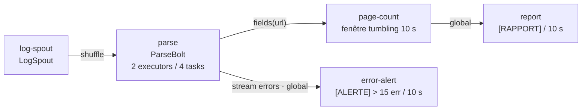

# LogStorm ⚡


**Surveiller en temps réel les logs d'un site e-commerce avec Apache Storm : classement des
pages toutes les 10 secondes et alerte instantanée sur les rafales d'erreurs 5xx — le tout sur
un cluster complet qui tourne sur votre PC grâce à Docker.**

Projet pédagogique (TP) du module *Big Data avancé*, pour découvrir Storm de bout en bout :
installation, cluster, Storm UI, code, déploiement, mise à l'échelle et tolérance aux pannes.

## La topologie



1. **LogSpout** génère ~200 lignes de log Apache par seconde (rafale de 35 % d'erreurs 500/503
   pendant 10 s toutes les 40 s), avec émission fiable et rejeu.
2. **ParseBolt** extrait `url`, `status`, `latency` et envoie les 5xx sur un 2e stream `errors`.
3. **PageCountBolt** compte les requêtes par URL sur une fenêtre tumbling de 10 s.
4. **ReportBolt** affiche le classement toutes les 10 s (tick tuple).
5. **ErrorAlertBolt** lève une alerte au-delà de 15 erreurs 5xx sur 10 s glissantes.

Diagrammes détaillés (cluster + parallélisme) : [docs/architecture.md](docs/architecture.md).

## Prérequis

- **Docker Desktop** (Compose v2) — Windows (WSL 2), macOS ou Linux — avec ≥ 4 Go de RAM alloués
- **Git**
- *(optionnel)* `make` ; un JDK 25 et Maven ne sont **pas** nécessaires

Pas à pas : [docs/01-installation.md](docs/01-installation.md).

## Démarrage rapide en 5 commandes

```bash
git clone https://github.com/<pseudo>/logstorm.git && cd logstorm   # 1. récupérer le projet
docker compose up -d --scale supervisor=2                            # 2. cluster : ZK + Nimbus + 2 supervisors + UI
./scripts/build.sh                                                   # 3. compiler (Maven dans Docker)
./scripts/local.sh                                                   # 4. tester 60 s en mode local
./scripts/deploy.sh                                                  # 5. déployer sur le cluster
```

PowerShell : `.\scripts\build.ps1`, `.\scripts\local.ps1`, `.\scripts\deploy.ps1`.
Avec make : `make up2 build local deploy`.

Puis ouvrez **<http://localhost:8080>** (Storm UI) et suivez les résultats avec `make logs`
(ou `bash scripts/logs.sh`).

## Ce que vous devez voir

Exemple de sortie (les valeurs varient, la génération est aléatoire) :

```
[RAPPORT] Requêtes par page (10 dernières secondes)
  /produits        241 req   latence moy.  139 ms
  /panier          236 req   latence moy.  127 ms
  /recherche       230 req   latence moy.  131 ms
  /api/stock       228 req   latence moy.  144 ms
  /compte          225 req   latence moy.  136 ms
  /                221 req   latence moy.  128 ms
  /paiement        219 req   latence moy.  141 ms
  /produits/42     214 req   latence moy.  133 ms

[ALERTE] 16 erreurs 5xx en 10 s (dernière sur /paiement, statut 503)
```

## Commandes Makefile

| Cible | Effet |
|---|---|
| `make up` | démarre le cluster (1 supervisor) |
| `make up2` | démarre le cluster avec 2 supervisors |
| `make ps` | état des conteneurs |
| `make build` | compile `target/logstorm-1.0.jar` via l'image Maven |
| `make local` | mode local pendant 60 s |
| `make deploy` | `storm jar` + `storm list` |
| `make list` | `storm list` |
| `make logs` | suit `[RAPPORT]` / `[ALERTE]` sur les 2 supervisors |
| `make rebalance` | 3 workers et 4 executors pour `parse`, à chaud |
| `make chaos` | arrête `supervisor-2` 60 s puis le relance |
| `make heal` | relance `supervisor-2` |
| `make kill` | `storm kill logstorm -w 5` |
| `make down` | `docker compose down` |
| `make clean` | supprime `target/` |

Équivalents sans make : [docs/07-commandes.md](docs/07-commandes.md).

## Documentation (le TP pas à pas)

| # | Document | Contenu |
|---|---|---|
| 1 | [Installation](docs/01-installation.md) | Docker Desktop sur Windows / macOS / Linux, WSL 2, vérifications |
| 2 | [Le cluster](docs/02-cluster.md) | chaque service du `docker-compose.yml`, ports, `--scale` |
| 3 | [Storm UI](docs/03-storm-ui.md) | visite guidée : où cliquer, que lire |
| 4 | [Concepts](docs/04-concepts.md) | tuple, stream, spout, bolt, parallélisme, groupings, acking, fenêtrage |
| 5 | [Le code expliqué](docs/05-code-explique.md) | chaque classe, bloc par bloc |
| 6 | [La démo](docs/06-demo.md) | déroulé minute par minute, plan B, exercices |
| 7 | [Commandes](docs/07-commandes.md) | aide-mémoire |
| 8 | [Dépannage](docs/08-depannage.md) | symptôme → cause → solution |
| — | [Architecture](docs/architecture.md) | diagrammes Mermaid |
| — | [Support de cours (PDF)](docs/Apache_Storm_Cours_Complet.pdf) | cours complet Apache Storm |

## Structure du dépôt

```
logstorm/
├── docker-compose.yml   .env   pom.xml   Makefile
├── scripts/             build, local, deploy (.sh + .ps1), logs.sh, chaos.sh
├── docs/                le TP en 8 étapes + architecture + cours PDF
└── src/main/java/com/bigdata/logstorm/
    ├── LogStormTopology.java
    ├── spout/LogSpout.java
    └── bolt/ParseBolt.java, PageCountBolt.java, ErrorAlertBolt.java, ReportBolt.java
```

## Ressources

- Site officiel : <https://storm.apache.org>
- Concepts : <https://storm.apache.org/releases/current/Concepts.html>
- Tutorial : <https://storm.apache.org/releases/current/Tutorial.html>
- Code source : <https://github.com/apache/storm>
- Exemples officiels (storm-starter) : <https://github.com/apache/storm/tree/master/examples/storm-starter>
- Image Docker officielle : <https://hub.docker.com/_/storm>

## Auteur

- **[Votre nom]** — [Module Big Data Avancé], année universitaire 2026-2027
- Encadrant : [Nom du professeur]

Licence [Apache 2.0](LICENSE).
