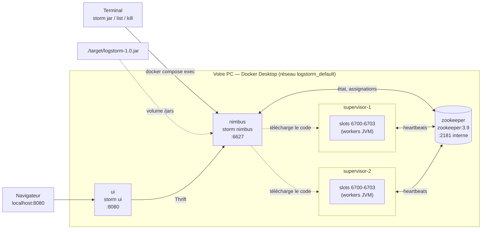
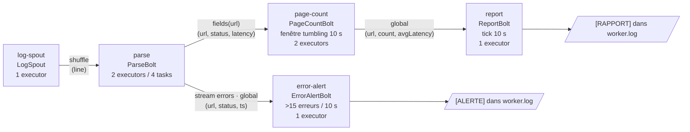
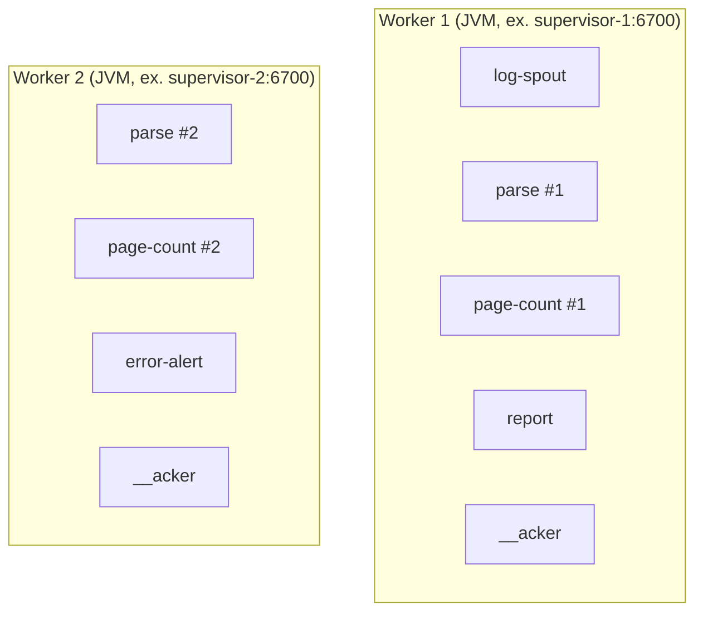

# Architecture de LogStorm

Deux vues : l'**infrastructure** (les conteneurs du cluster) et la **topologie** (le traitement).

## 1. Le cluster Storm dans Docker

- **Nimbus** ne parle jamais directement aux workers pendant le traitement : tout l'état
  partagé (qui fait quoi, qui est vivant) passe par **ZooKeeper**.
- Si un supervisor disparaît, ses heartbeats s'arrêtent ; Nimbus le voit dans ZooKeeper et
  réassigne ses workers ailleurs (démo `make chaos`).
- Les tuples, eux, circulent **directement de worker à worker** (réseau Netty), sans passer par Nimbus.

## 2. Le DAG de la topologie

| Arête | Grouping | Pourquoi |
|---|---|---|
| log-spout → parse | `shuffleGrouping` | parser une ligne ne dépend d'aucune clé : on équilibre la charge |
| parse → page-count | `fieldsGrouping("url")` | toutes les requêtes d'une même page doivent être comptées par la même task |
| page-count → report | `globalGrouping` | un seul classement final, donc une seule task |
| parse (`errors`) → error-alert | `globalGrouping` | un seul compteur d'erreurs pour tout le site |

## 3. Le parallélisme sur le cluster

Avec `setNumWorkers(2)` et 2 supervisors, le scheduler répartit les executors sur 2 JVM :

La répartition exacte change à chaque déploiement : regardez la page de la topologie dans
Storm UI (colonnes *Host* et *Port* d'un composant) pour savoir où tourne quoi.
